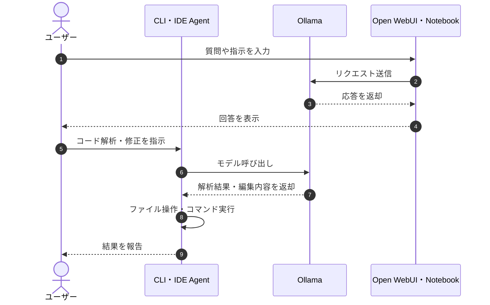

# local_llm (Local LLM Environment)

Ollama、Open WebUI、Open Notebook、および CLI Agent を Docker Compose で統合したローカル LLM 環境です。

## Quick Reference

```bash
# コンテナ起動（必要に応じて .env.example を .env にコピーして認証情報を設定）
docker compose up -d

# think 制御プロキシも含めて起動する場合
docker compose --profile proxy up -d

# ベースモデル取得 & カスタムモデル一括作成
docker compose exec ollama ollama pull bonsai-2:27b
./scripts/create_models.sh

# 稼働モデル・GPU使用状況の確認
watch -n 5 docker compose exec ollama ollama ps

# CLI Agent コンテナ起動
docker compose --profile cli run --rm cliagent
```

---

## 詳細

### サービス一覧
| サービス        | 用途                                                | URL / ポート                              |
| :-------------- | :-------------------------------------------------- | :---------------------------------------- |
| `ollama`        | LLM 推論エンジン (API)                              | `http://localhost:11434`                  |
| `ollama-proxy`  | `think` 制御用リバースプロキシ（`--profile proxy`） | `http://localhost:11435`                  |
| `openwebui`     | チャット Web UI                                     | `http://localhost:8081`                   |
| `open_notebook` | ノートブック UI (API / DB)                          | `http://localhost:8502` (`5055` / `8000`) |
| `cliagent`      | OpenCode / Continue CLI / Crush（`--profile cli`）  | `network_mode: host`                      |

### ファイル構成
| パス                                       | 役割                                                    |
| :----------------------------------------- | :------------------------------------------------------ |
| `docker-compose.yml`                       | 各サービスのコンテナ・GPU・環境変数定義                 |
| `.env.example`                             | 認証情報・プロキシ設定の環境変数テンプレート            |
| `Dockerfile`                               | `cliagent` イメージ定義                                 |
| `proxy/ollama_think_proxy.py`              | Ollama `/api/chat` 向け `think` パラメータ注入プロキシ  |
| `modelfile/bonsai-2.5:27b-agent.Modelfile` | Bonsai 2.5 (27B) RTX 4080 (16GB) 向け定義               |
| `modelfile/bonsai-2:27b-agent.Modelfile`   | Bonsai 2 (27B) RTX 4080 (16GB) 大規模コード解析向け定義 |
| `templates/agent.Modelfile`                | 新規カスタムモデル作成用テンプレート                    |
| `scripts/create_models.sh`                 | `modelfile/*.Modelfile` からモデルを作成するスクリプト  |
| `opencode.json`                            | OpenCode CLI 用設定                                     |
| `config.yaml`                              | Continue CLI 用設定                                     |
| `AGENTS.md`                                | エージェント向け共通指示                                |
| `volumes/` / `tmp/`                        | 永続化データ / 一時退避用（Git 管理外）                 |

### モデルの管理・カスタマイズ
- **新規モデル作成**: `templates/agent.Modelfile` を `modelfile/<モデル名>.Modelfile` にコピーして編集し、`./scripts/create_models.sh`（または `./scripts/create_models.sh <モデル名>`）を実行します。
- **プル済みモデルの一括更新**:
  ```bash
  docker compose exec ollama bash -c "ollama list | tail -n +2 | awk '{print \$1}' | xargs -n1 ollama pull"
  ```

### GPU 最適化設定（RTX 4080 16GB）
`docker-compose.yml` の `ollama` サービスで以下の環境変数を設定し、大コンテキスト（128K）を単一 GPU で安定稼働させています。
- `OLLAMA_FLASH_ATTENTION=1` — Flash Attention 有効化（高速化・VRAM 削減）
- `OLLAMA_KV_CACHE_TYPE=q8_0` — KV キャッシュ 8bit 量子化（VRAM 消費を抑制）
- `OLLAMA_NUM_PARALLEL=1` — 並列推論を無効化し、単一セッションに VRAM を集中
- `OLLAMA_MAX_LOADED_MODELS=1` — 同時ロードを 1 モデルに制限

### CLI / IDE 連携
- **GitHub Copilot Chat (VS Code)**:
  - Thinking モデルの長考によるタイムアウト・空応答を防ぐため、Ollama 接続先を `http://localhost:11435`（`ollama-proxy`）に設定して利用します。
  - `.env` または `docker-compose.yml` の `THINK_MODE`（`false` / `low` / `medium` / `high`）で思考強度を切り替えられます（変更時は `docker compose --profile proxy up -d ollama-proxy`）。
- **OpenCode / Continue CLI**: `cliagent` コンテナ内で `opencode` または `cn --config config.yaml -p "指示"` を実行します（外部コードを参照する場合は `docker-compose.yml` の `cliagent.volumes` にマウントを追加してください）。
- **Continue (VS Code 拡張)**: [Continue](https://marketplace.visualstudio.com/items?itemName=Continue.continue) からも Ollama 上のモデルを利用できます。

---

## システム構成図



---

## 参考
- [Ollama Library](https://ollama.com/library) — 利用可能なモデル一覧
